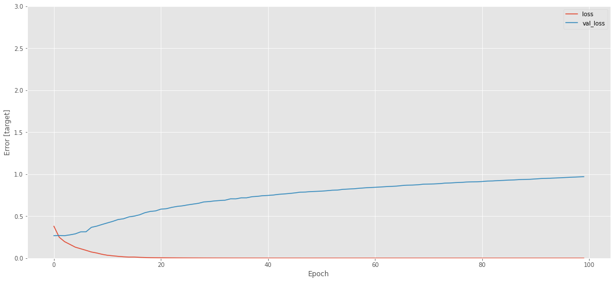

# American Express Default Prediction (Kaggle competition)

**Question:** Using up to 13 monthly statements per customer, predict the probability that a credit card customer will **default**, that is, fail to pay back the balance.

**Why it matters:** Credit default models decide who gets credit, at what limit and at what price. Better ranking of risk means fewer losses for the lender and fairer access to credit for good customers. The competition data are realistic: hundreds of anonymised behavioural variables, many missing values, a time series per customer, and a business oriented metric.

**Skills shown:** large tabular data handling (Parquet, memory aware dtypes), customer level time series aggregation, missing value strategy, categorical encoding, correlation filtering, null importance feature selection, gradient boosting (LightGBM) with early stopping, stratified K fold cross validation, implementing a custom competition metric, probability calibration, decision thresholds, and building a model comparison (gradient boosting, logistic regression, neural network) in the original work.

---

## Competition and data

Kaggle competition [**American Express - Default Prediction**](https://www.kaggle.com/competitions/amex-default-prediction) (2022). Download the data there; it is several GB, and the community Parquet versions load much faster than the CSV files.

| File | Content |
|---|---|
| `train_data` | statements: `customer_ID`, statement date `S_2`, and roughly 190 anonymised features |
| `train_labels` | `customer_ID`, `target` (1 = default) |
| `test_data` | statements for the customers to predict |

Feature groups: **D_\*** delinquency, **S_\*** spend, **P_\*** payment, **B_\*** balance, **R_\*** risk. The organisers list 11 of them as categorical: B_30, B_38, D_114, D_116, D_117, D_120, D_126, D_63, D_64, D_66, D_68.

**Metric:** M = ½ (G + D), where G is the normalised weighted Gini coefficient and D is the share of defaults captured among the 4 % of customers with the highest predicted risk. Non defaults carry weight 20 because they were down sampled. The metric depends only on the **ranking** of predictions, so a submission must contain probabilities, not 0/1 labels. `amex_metric()` in the script reproduces Kaggle's reference implementation exactly; this was checked on random data to six decimals.

## How to run

```bash
pip install -r ../requirements.txt
python amex_default_prediction.py \
    --train data/train_data.parquet --labels data/train_labels.csv \
    --test data/test_data.parquet \
    --max-customers 50000          # optional: a subset for a laptop
    --null-importance 20           # optional: feature ranking (slow)
```

These are the outputs:
* `results/oof_summary.csv`: out of fold metric, AUC, Gini, 4 % capture, log loss, Brier score, and accuracy, precision and recall at the F1 optimal threshold, for each model
* `results/lightgbm_feature_importance.csv` and `figures/02_feature_importance.png`
* `figures/03_roc_calibration_threshold.png`
* `results/submission.csv`: `customer_ID,prediction` with probabilities averaged over the folds

## Pipeline

```
statements ──► drop columns > 70 % missing (learned on train)
           ──► per customer aggregates
                 numeric : mean, std, min, max, last, last − mean
                 categorical : last value (one hot), number of distinct values
                 + number of statements
           ──► correlation filter (|r| > 0.95)
           ──► optional null importance ranking
           ──► 5 fold stratified CV:  LightGBM (early stopping)  |  logistic regression
           ──► out of fold evaluation, figures, probability submission
```

Design decisions:
* **Last value and trend features.** A customer's most recent statement, and how it differs from their own average, carry more signal about imminent default than an average alone.
* **No zero filling before aggregation.** For many features 0 is a real value, so filling missing values with 0 distorts the mean, min and std. LightGBM handles missing values natively; the logistic regression gets median imputation inside its pipeline, so nothing leaks between folds.
* **float32 instead of float16.** float16 keeps only about 3 significant digits, which visibly changes values (in the original run, `P_2` 0.933824 became 0.933594).
* **Whole customers.** `--max-customers` keeps complete histories. Reading the first N rows can cut a customer's history in half.

> **Verification note.** The competition data could not be downloaded where this code was rebuilt. The pipeline was run end to end on a **synthetic** data set with the same structure (3,000 customers, 1 to 13 statements, numeric and categorical features, missing values) to prove that every step works, including the submission format. The synthetic scores are meaningless, so they are not reported. The results below are from the original notebook.

---

## Original work and results

The original notebook, `american-express-default-prediction-competition.ipynb`, was developed on a **subset of 19,999 statement rows (1,664 customers, default rate 27.0 %)** and a test subset of 1,619 customers.

1. **Features.** Dropped columns more than 70 % missing and `D_64`, and one hot encoded `D_63`. Then aggregated each customer with mean, min, max, std and the 25th, 50th, 75th and 90th percentiles, giving **1,336 features**.
2. **Feature selection.** Combined permutation importance (gradient boosting and random forest), a correlation filter at |r| > 0.90 (which kept 586 features), and null importance with 80 shuffled LightGBM runs, ending with **398 selected features**.
3. **Models** (80/20 split of the 1,664 customers):

| Model | Train accuracy | Test accuracy | Test precision | Test recall |
|---|---|---|---|---|
| LightGBM (500 trees, depth 5) | 100.0 % | 86.8 % | 80.0 % | 75.3 % |
| LightGBM + sigmoid calibration, threshold 0.339 (chosen on the test split) | not measured* | 88.6 % | 81.4 % | 79.8 % |
| Gradient boosting (scikit-learn) | 98.9 % | 89.2 % | 79.7 % | 73.8 % |
| Gradient boosting, repeated 10 fold CV | | 86.1 % ± 3.1 % (accuracy) | | |
| Neural network (Keras, 2 × 64 ReLU) | 97.5 % | 85.0 % | 76.5 % | 66.7 % |
| TensorFlow linear classifier (logistic) | 94.1 % | 84.1 % | 73.5 % | 74.3 % |

\*The training scores printed for the calibrated model were computed from the uncalibrated predictions (the two variables were swapped), so they are left out.

**Reading these numbers honestly:**
* The large gap between training (98 to 100 %) and test (84 to 89 %) accuracy shows **overfitting**, which is expected with 1,336 features and only 1,331 training customers.
* The neural network's validation loss **rose** steadily after the first epochs while its training loss fell to about 0, the classic overfitting curve:

  

* The models were compared on a single 333 customer test split, so differences of 2 to 3 points are within noise (the CV standard deviation was 3.1 points).

### Errors found in the original code, and their fixes

| Issue | Consequence | Fix |
|---|---|---|
| `np.ravel(model.predict_proba(X))` used for the probability submissions | `predict_proba` returns two columns (P(no default), P(default)). Flattening interleaves them, giving **3,238 values for 1,619 customers**. Matched to customer IDs, most rows received the wrong customer's value, and the wrong column | `predict_proba(X)[:, 1]` |
| The "raw" calibrated submission file was built from the **uncalibrated** predictions, and the threshold step read the uncalibrated file twice | The calibrated and uncalibrated submissions were identical | One clearly named prediction per model |
| Submissions thresholded to 0/1 | The competition metric ranks probabilities, so 0/1 labels discard most of the information | Probabilities are submitted |
| The classifier comparison reused an `acc_dict` from another notebook and divided one split's accuracy by 10 | The chart showed accuracies of about 0.18 for every model, which is meaningless | Proper K fold out of fold scoring |
| Permutation importance computed on the test split, and the same data re-split for the final evaluation; thresholds tuned on the test split | Selection and tuning saw the test data, so the reported scores are optimistic | All choices made inside the training folds; thresholds chosen on out of fold predictions |
| Test features normalised with the **test set's own** mean and std (`norm(test_features)`) | Train and test were on different scales | Scaler fitted on training data inside a pipeline |
| `fillna(0)` before aggregation | Biased aggregates (see above) | NaN aware aggregation |
| `float16` in `reduce_mem_usage` | Precision loss | float32 |
| Accuracy of a classifier printed as "R2 score" | Wrong metric name | The competition metric plus classification metrics |
| A noise removal cell crashed (`TypeError`), and several cells referenced undefined variables or ran out of order (`training_features`, `tarin_sel`, `pm_imp`) | The notebook could not be re-run top to bottom | One script that runs end to end |
| `tf.estimator` `LinearClassifier` and `LinearRegressor` | Removed from TensorFlow 2.16 and later | scikit-learn logistic regression baseline |

### Competition result

I entered as a solo competitor and finished 4,137th of 4,874 teams on the final leaderboard (Kaggle profile `aadeniyi`). This was my first Kaggle competition. My final selected submission was a LightGBM model built after feature engineering and feature selection, with a private score of 0.76906 and a public score of 0.76285. I processed the full training data remotely on the CHPC national cluster in South Africa, because it was too large for a Jupyter notebook.

The scripts from that run were not kept. The notebook I kept, which this review is based on, trained on a sample of about 20,000 statement rows (1,664 customers), so it does not reproduce the submitted result.

What the review found and what I can show:

* **0/1 labels hurt the score.** The competition metric rewards a good ranking of probabilities. My three submissions that were thresholded to 0 or 1 scored about 0.51 (private), against about 0.77 for the two probability submissions I selected. The Kaggle submissions page shows both sets of scores.
* **A flattening bug in the notebook.** The notebook I kept flattens the model output with `np.ravel(predict_proba(...))`, which would misalign probabilities with customer IDs. My selected submissions score about 0.77, far above what misaligned predictions would give, so they were not affected. I can no longer tell which earlier submissions, if any, used the buggy code.
* **Modest ranking.** I did not have the time or the experience to tune the model, calibrate it carefully or build an ensemble. This is a judgment about the result, not something I measured.

The rebuilt pipeline in this folder uses the full data or a customer level subset, submits probabilities, and takes `predict_proba(X)[:, 1]` explicitly. It has been tested only on synthetic data with the real schema, and it has not been scored on the leaderboard. The Kaggle page still shows a Late Submission button, so a late submission appears to be possible and would give a private score to compare with 0.76906.

### Ideas for the next iteration
* Train on the full data (all customers) with the Parquet files, where boosted trees typically gain the most.
* Add difference and lag features (the last statement minus the previous one) and rolling windows.
* Blend LightGBM with an XGBoost or CatBoost model and a GRU over the statement sequence.
