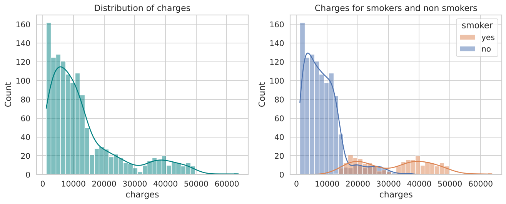
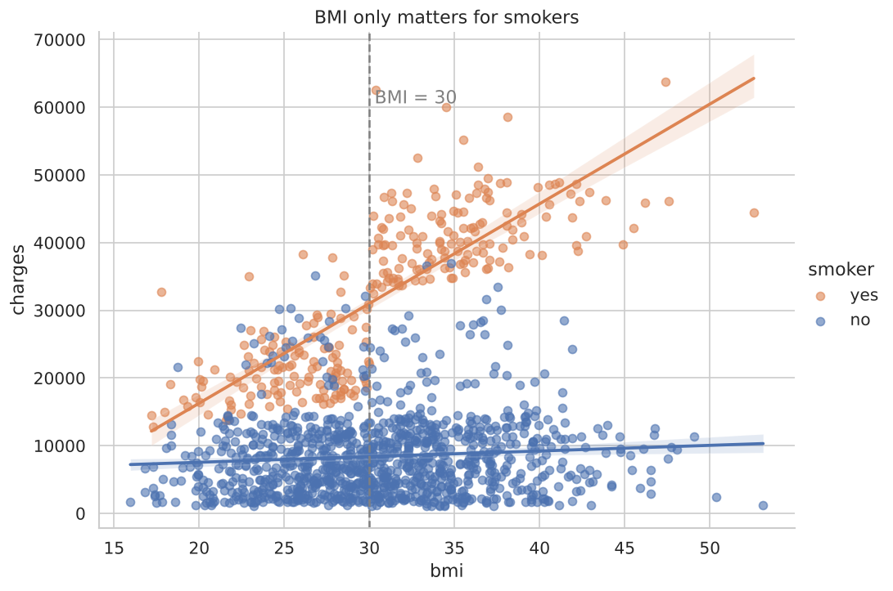
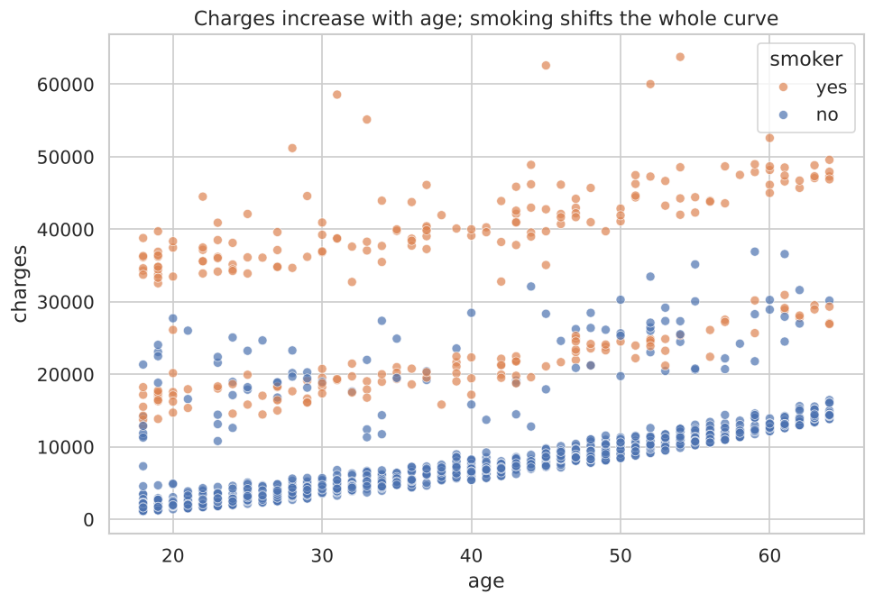
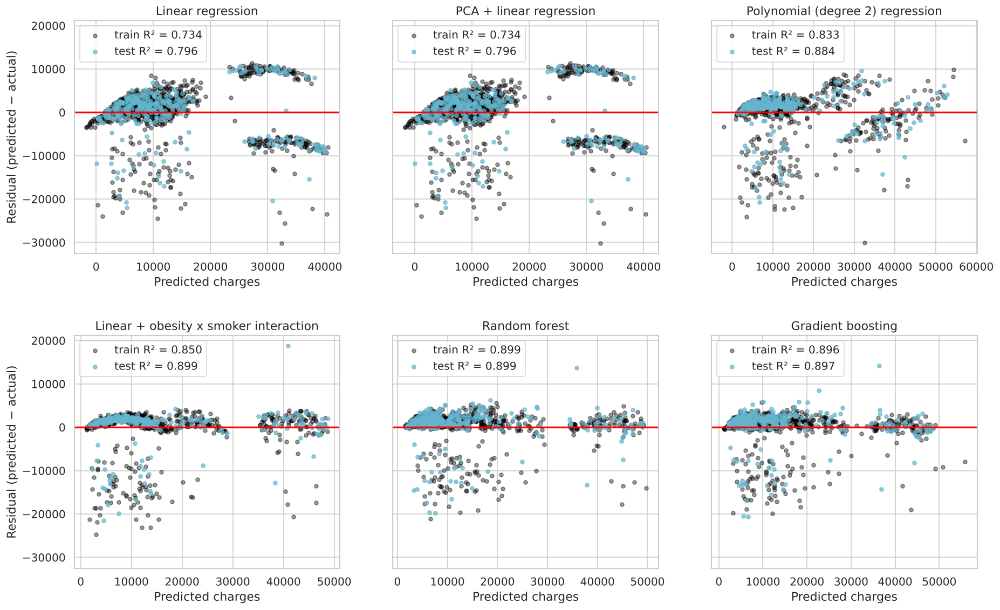

# Medical Insurance Cost Analysis and Prediction

**Question:** Which personal factors drive a person's yearly medical insurance charges, and how well can those charges be predicted?

**Why it matters:** Insurers use this kind of analysis to set fair premiums and to target prevention programs. For an individual or a family, it shows which factors they can actually change (smoking, body weight) and how large the financial effect is. The same workflow applies to any pricing problem where the cost depends on a few customer attributes.

**Skills shown:** exploratory data analysis, statistical hypothesis testing, feature engineering based on domain knowledge, regression modelling (linear, polynomial, PCA, random forest, gradient boosting), leakage-free scikit-learn pipelines, cross validation, residual analysis and permutation importance.

---

## Data

The public **Medical Cost Personal Datasets** file (`insurance.csv`): 1,338 people and 7 columns, with no missing values.

| Column | Meaning |
|---|---|
| `age` | age of the primary beneficiary (18 to 64) |
| `sex` | female / male |
| `bmi` | body mass index, kg/m² |
| `children` | number of dependants covered |
| `smoker` | yes / no |
| `region` | US region: northeast, northwest, southeast, southwest |
| `charges` | individual medical costs billed by the insurer (some copies call this column `expenses`) |

```bash
mkdir -p data
curl -L -o data/insurance.csv https://raw.githubusercontent.com/stedy/Machine-Learning-with-R-datasets/master/insurance.csv
```

## How to run

```bash
pip install -r ../requirements.txt
python insurance_cost_analysis.py --data data/insurance.csv
```

Figures go to `figures/` and metric tables to `results/`. All the numbers below come from `results/run_log.txt`, which this script produced.

---

## Analysis and findings

### 1. The target is strongly right skewed
The median charge is 9,382 USD and the mean is 13,270 USD, with a long tail up to 63,770 USD. When the data are skewed like this, medians describe a typical person better than means do.



### 2. Smoking is the dominant factor
Here is how each factor correlates with charges (Pearson r):

| Factor | r |
|---|---|
| smoker | **0.787** |
| age | 0.299 |
| bmi | 0.198 |
| children | 0.068 |
| sex (male) | 0.057 |

A one sided Mann Whitney U test was used because the charges are not normally distributed. It confirms that smokers pay more (p ≈ 2.6 × 10⁻¹³⁰). The median smoker is charged 34,456 USD, which is **4.7 times** the 7,345 USD charged to the median non smoker. There are 274 smokers and 1,064 non smokers.

### 3. Obesity matters, but almost only for smokers
This is the most useful finding of the project:

| Median charges (USD) | BMI < 30 | BMI ≥ 30 |
|---|---|---|
| Non smoker | 6,762 | 8,076 |
| Smoker | 20,167 | **40,904** |

For non smokers, obesity (BMI ≥ 30, the WHO cut off) adds about 1,300 USD. For smokers it doubles the cost. The scatter plot shows a sharp step at BMI 30 for smokers only.



### 4. Age raises costs steadily
Charges grow roughly linearly with age, and the plot shows three parallel bands. The lowest band is almost entirely non smokers. The top band, near 40,000 USD, is smokers only, which matches the median for obese smokers in the table above. The middle band mixes smokers with a lower BMI and a minority of non smokers with unusually high costs (possibly serious illness or accidents, which this data set does not record).



## Modelling

Every model used the same 75/25 split (random_state = 0) and was also scored with 5 fold cross validation. Region was one hot encoded inside the pipeline.

| Model | Train R² | Test R² | Test RMSE (USD) | 5 fold CV R² |
|---|---|---|---|---|
| Linear regression | 0.734 | 0.796 | 5,669 | 0.740 ± 0.052 |
| PCA + linear regression | 0.734 | 0.796 | 5,669 | 0.740 ± 0.052 |
| Polynomial (degree 2) | 0.833 | 0.884 | 4,270 | 0.836 ± 0.040 |
| **Linear + obesity × smoker feature** | 0.850 | **0.899** | **3,979** | **0.858 ± 0.033** |
| Random forest | 0.899 | 0.899 | 3,984 | 0.852 ± 0.042 |
| Gradient boosting | 0.896 | 0.897 | 4,034 | 0.854 ± 0.038 |

**Lesson:** one feature built from the EDA (`obese_smoker = smoker AND BMI ≥ 30`) lets a plain linear model match or beat random forests and gradient boosting. The linear model also stays fully interpretable. Its permutation importance ranks `obese_smoker` (0.53) and `is_smoker` (0.37) first, then age (0.17). Sex, region and number of children contribute almost nothing.



The residual plots show why: the plain linear model leaves two separate clouds of large errors (the smoker groups). The interaction feature removes them.

---

## What changed from the original notebook

The original notebook (`insurrance-project.ipynb`) was converted into one script that runs top to bottom and is reproducible. The analysis was kept. These errors were corrected:

| Issue in the original | Why it matters | Fix |
|---|---|---|
| PCA was fitted **separately on the test set** (`testpca.fit(x_test)`) | Train and test were projected onto different axes, so the reported test R² of 0.671 was meaningless | PCA sits inside a pipeline fitted on training data only. With all components kept, PCA is only a rotation, so it reproduces plain linear regression exactly (0.796) |
| Comment said "women are coded 1, men 0" | `LabelEncoder` sorts alphabetically, so **female = 0, male = 1**. The sex plots were read the wrong way round | Explicit columns `is_male` and `is_smoker` |
| `region` was label encoded 0 to 3 and then correlated with charges | Region is nominal; the numbers 0 to 3 have no order, so a correlation is not meaningful | One hot encoding |
| `dataset2['smoker'].map({'0': 2, '1': 3})` on an integer column | Turned every value into NaN (it was unused, but wrong) | Removed |
| `ax.set_title(...)` applied to a stale axis after `jointplot` and `lmplot` | Titles landed on the wrong figure | Titles set on the right axes |
| `criterion='mse'`, `sns.distplot`, `size=` | Removed or deprecated in current scikit-learn and seaborn | Current API |
| "R² ± std" of a single number | A standard deviation needs several scores | 5 fold CV mean ± std |

The data copy used here stores BMI with two decimals; the original notebook's copy rounded it to one. The headline numbers match closely: linear regression test R² was 0.795 in the original run and is 0.796 here; for the degree 2 polynomial it was 0.885 and is 0.884.
