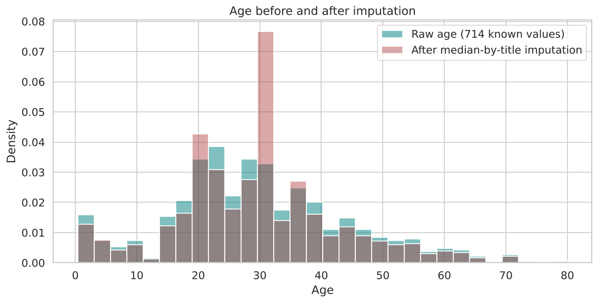
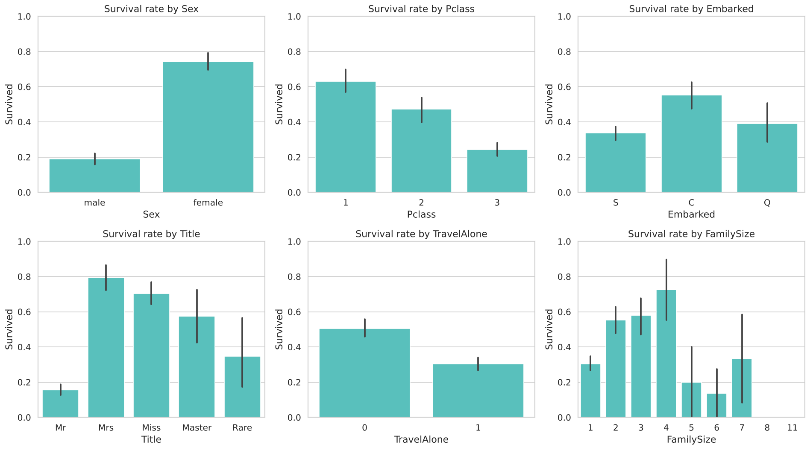
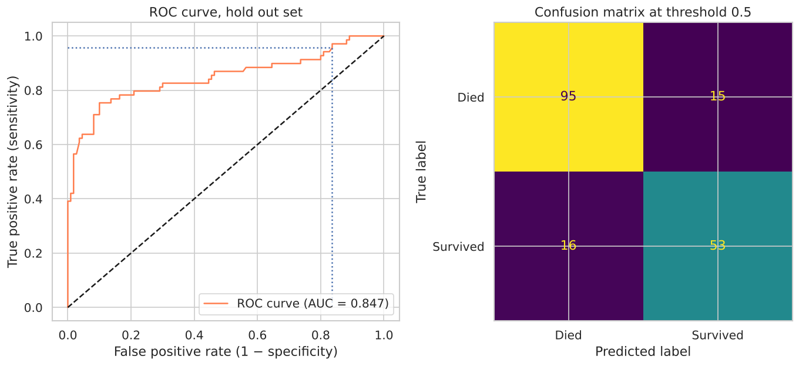
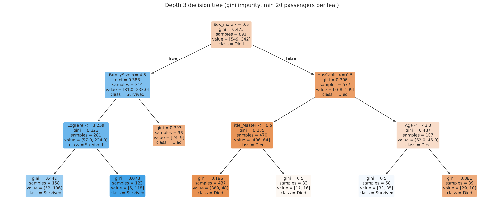

# Titanic Survival: Analysis and Classification

**Question:** Who survived the sinking of the Titanic, and how well can survival be predicted from passenger records?

**Why it matters:** This is a small, well understood data set, which makes it a good place to show a complete and careful classification workflow: data quality checks, imputation without leakage, feature engineering, honest model comparison, feature selection, tuning, and interpretation. The same steps apply to churn, credit default, or patient outcome problems.

**Skills shown:** missing value strategy, regex feature extraction, fit/transform design that avoids test set leakage, stratified cross validation, ten classifier benchmark, RFECV, grid search with several scorers, ROC analysis and threshold choice, odds ratio interpretation, decision tree visualisation.

---

## Data

Kaggle "Titanic: Machine Learning from Disaster": `train.csv` has 891 passengers with the outcome, and `test.csv` has 418 passengers without it.

| Column | Meaning |
|---|---|
| `Survived` | 0 = died, 1 = survived (target) |
| `Pclass` | ticket class 1, 2, 3 (a proxy for socio economic status) |
| `Name`, `Sex`, `Age` | passenger details |
| `SibSp`, `Parch` | siblings or spouses, parents or children aboard |
| `Ticket`, `Fare`, `Cabin` | ticket number, fare paid, cabin number |
| `Embarked` | port: C = Cherbourg, Q = Queenstown, S = Southampton |

```bash
mkdir -p data
curl -L -o data/train.csv https://raw.githubusercontent.com/datasciencedojo/datasets/master/titanic.csv
curl -L -o data/test.csv  https://raw.githubusercontent.com/agconti/kaggle-titanic/master/data/test.csv
```
(Both are copies of the Kaggle files. The two training copies checked for this project were byte identical, MD5 `61fdd54abdbf6a85b778e937122e1194`.)

## How to run

```bash
python titanic_survival_analysis.py --train data/train.csv --test data/test.csv
```

The script writes figures to `figures/` and writes the tables, `submission.csv` and `run_log.txt` to `results/`.

---

## 1. Data quality

| Column | Missing | Decision |
|---|---|---|
| Cabin | 687 (77.10 %) | Too sparse to impute. Instead it becomes a flag, `HasCabin`, because a *known* cabin is informative: 66.7 % of those passengers survived, against 30.0 % of the rest |
| Age | 177 (19.87 %) | Age is right skewed (mean 29.70, median 28.00), so the median is used. It is taken **per title**, learned on the training data: Master 3.5, Miss 21, Mr 30, Mrs 35, Rare 48.5. A boy called "Master" should not get the adult median of 28 |
| Embarked | 2 (0.22 %) | Filled with the most common port, S |
| Fare (test only) | 1 | Filled with the training median |



## 2. Who survived?

These rates are from the 891 training passengers (overall survival rate 38.4 %):

| Group | Survival rate |
|---|---|
| Female / male | **74.2 %** / 18.9 % |
| 1st / 2nd / 3rd class | 63.0 % / 47.3 % / 24.2 % |
| Title Mrs / Miss / Master / Mr | 79.4 % / 70.3 % / 57.5 % / **15.7 %** |
| Age 0 to 16 / 65 and over | 54.8 % / 9.1 % |
| Cheapest / most expensive fare quartile | 19.7 % / 58.1 % |
| Travelling alone / with family | 30.4 % / 50.6 % |
| Family size 4 / 5 / 6 / 8 and 11 | 72.4 % / 20.0 % / 13.6 % / 0 % |

The pattern matches the "women and children first" rule and a strong class gradient. Families of two to four did best. Large families did very poorly; 54 of the 62 passengers in families of five or more travelled in third class.



## 3. Classifier comparison

All ten models used the same engineered features and stratified 10 fold cross validation:

| Classifier | Accuracy (mean ± std) | ROC AUC |
|---|---|---|
| SVC (RBF kernel) | 0.834 ± 0.037 | 0.848 |
| Linear discriminant analysis | 0.834 ± 0.044 | 0.871 |
| Logistic regression | 0.832 ± 0.039 | 0.871 |
| Random forest | 0.830 ± 0.041 | 0.875 |
| Gradient boosting | 0.829 ± 0.032 | 0.868 |
| AdaBoost | 0.825 ± 0.047 | 0.864 |
| Quadratic discriminant | 0.822 ± 0.042 | 0.867 |
| k nearest neighbours (k = 3) | 0.802 ± 0.046 | 0.829 |
| Decision tree (unpruned) | 0.787 ± 0.038 | 0.774 |
| Gaussian naive Bayes | 0.774 ± 0.048 | 0.845 |

The top seven models are within one standard deviation of each other. With 891 rows the data cannot separate them, so the simplest interpretable model, logistic regression, is the sensible choice.

## 4. Logistic regression in depth

1. **RFECV** on the training split selected 12 of 15 features.
2. **Grid search over C** (10 fold CV, scored on accuracy, ROC AUC and log loss) chose C = 0.178. At that value the CV accuracy is 0.834 ± 0.028, ROC AUC 0.881 and log loss 0.410.
3. **Hold out test (20 %, stratified, never used for selection or tuning):** accuracy 0.827, ROC AUC 0.847, log loss 0.441. For survivors the precision is 0.779 and the recall 0.768.
4. **Threshold trade off:** catching at least 95 % of survivors needs a threshold of 0.069, which lets through 83.6 % false positives. A screening decision needs this kind of number, and accuracy alone hides it.



**Odds ratios** for the main features. All other features are held constant. The reference levels are 3rd class, Southampton and the title "Mr"; for 0/1 features the ratio compares present with absent:

| Feature | Odds ratio per unit | Reading |
|---|---|---|
| Sex_male | **0.17** | a man had about one sixth of the survival odds of a comparable woman |
| Title_Master | 15.3 | boys ("Master") had far higher odds than adult men ("Mr") |
| Title_Mrs / Title_Miss | 5.2 / 2.6 | compared with "Mr" |
| Pclass_1 / Pclass_2 | 2.9 / 2.7 | compared with 3rd class |
| HasCabin | 2.6 | a recorded cabin is linked to survival |
| FamilySize | 0.66 per extra family member | larger families did worse |
| Age | 0.974 per year | about 2.6 % lower odds for each year of age |

A depth 3 decision tree tells the same story as a flow chart. It splits on sex first, then on family size for women and on cabin, title and age for men:



---

## What changed from the original notebook

The original notebook was `titanic-logical-regression.ipynb`.

| Issue in the original | Why it matters | Fix |
|---|---|---|
| In the first classifier comparison, `X = train2[:, 1:]; y = train2[:, 0]`, but column 0 was **Age**, not Survived | That chart ranked models on predicting the **age band**, not survival | Explicit `X` and `y`, with the target taken by name |
| The accuracy of `LogisticRegression` was printed as "Train R²" | R² is a regression metric | Labelled as accuracy |
| Test set ages and fares filled with **test set** medians | Statistics from the test set leaked into preprocessing | A `TitanicFeatures` fit/transform class learns every statistic on the training data |
| Title coded as 1 to 5 (Mr = 1 ... Rare = 5) | This imposes an order that does not exist | One hot encoding with a reference level |
| All dummy columns kept (Pclass_1, 2 and 3 together) | Perfect collinearity, so the coefficients cannot be interpreted | One reference level dropped |
| RFECV and grid search run on all rows, then evaluated on the same rows | Optimistic scores | Selection and tuning on the training split; the hold out is scored once |
| `DataFrame.append`, `rfecv.grid_scores_`, positional `sns.barplot` arguments, `dtreeviz` and `graphviz` | Removed or changed in current libraries | Current APIs; the tree is drawn with scikit-learn's `plot_tree` |
| No predictions for `test.csv` | | `--test` writes a Kaggle style `submission.csv` |

The original 10 fold CV accuracy for logistic regression was 0.807 ± 0.030 (AUC 0.859). The richer features here (title based ages, HasCabin, title dummies) raise it to about 0.83, with AUC 0.87 to 0.88.
