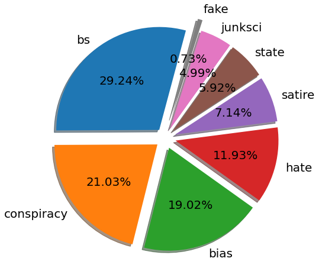
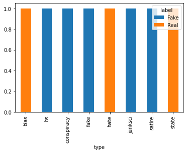
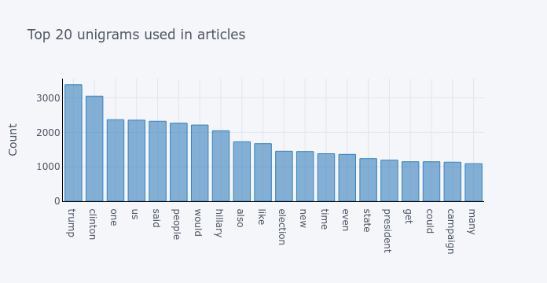
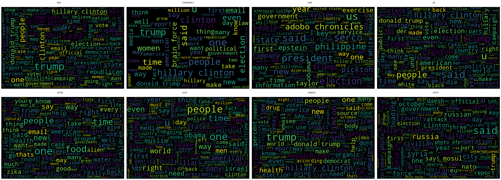

# Fake News: Text Analysis and Source Type Classification

**Question:** What separates articles from conspiracy, hate, satire, junk science and other unreliable sources? And can a model classify an article from its text alone?

**Why it matters:** Misinformation spreads faster than people can fact check it. Automatic triage of articles is useful for platforms, journalists and researchers. The project also teaches a lesson that matters in any text classification work: **a model can look accurate while it is only memorising the source**, so the evaluation design has to be chosen with care.

**Skills shown:** text cleaning, n-gram frequency analysis, word clouds, TF-IDF vectorisation, linear and ensemble text classifiers, macro F1 for imbalanced classes, grouped (by website) train/test splitting to detect leakage.

---

## Data

Kaggle data set **"Source based Fake News Classification"** (`news_articles.csv`). It holds 2,096 English language articles collected in October and November 2016, with 12 columns: author, published, title, text, language, site_url, main_img_url, type, label, title_without_stopwords, text_without_stopwords and hasImage. Download it from Kaggle into `data/news_articles.csv` (it is not redistributed here).

```bash
python fake_news_analysis.py --data data/news_articles.csv
```

> **Verification note.** The Kaggle file could not be downloaded in the environment where this code was rebuilt. The script was tested end to end on a synthetic file with the same columns. **All numbers and figures below come from the original notebook run on the real data** (`figures/original_run/`). Running the script on the real file will add the new three-design comparison.

---

## Findings from the original analysis

### Class structure
After removing the 51 rows with missing values, **2,045 articles** remain.

| type | articles | share | mean words* | share with image |
|---|---|---|---|---|
| bs | 598 | 29.2 % | 271 | 0.75 |
| conspiracy | 430 | 21.0 % | 250 | 0.67 |
| bias | 389 | 19.0 % | 211 | 0.94 |
| hate | 244 | 11.9 % | **508** | 0.59 |
| satire | 146 | 7.1 % | 280 | 0.68 |
| state | 121 | 5.9 % | 169 | 1.00 |
| junksci | 102 | 5.0 % | 320 | 1.00 |
| fake | **15** | 0.7 % | 311 | 1.00 |

\*Words counted after stop words were removed. Across all articles the median is 187 words and the maximum 3,015.

Two facts shape everything that follows:

1. **`label` is a fixed function of `type`.** Every article of type bias, hate or state is labelled *Real*, and every bs, conspiracy, fake, junksci or satire article is labelled *Fake* (figure below). So *Real* here means "not in a fake category". It does **not** mean "verified true", and hate and bias sites count as *Real*.
2. **The classes are very imbalanced.** The class literally named `fake` has only 15 articles, so accuracy alone can hide very poor performance on it.

| | |
|---|---|
|  |  |

### Language
The most frequent words and phrases reflect the 2016 US election: "trump", "clinton", "hillary clinton", "donald trump", "united states", "white house". The top trigrams also expose **boilerplate**: phrases such as "infowars life ... httpwwwinfowarscom..." are repeated promotional text and links, not article content. A production system would strip them, because they let a model identify the website rather than the writing.




### Websites
Of the websites in the data, 18 published articles labelled Real and 59 published articles labelled Fake. Nine appear in both lists, for example prisonplanet.com, frontpagemag.com and westernjournalism.com.

### Original model results
The original notebook trained on **`type` (8 classes)** using the website domain plus the article text, with a 70/30 random split:

| Model | Accuracy |
|---|---|
| AdaBoost (5 trees, depth 10) | 0.933 |
| Random forest (100 trees) | 0.866 |

---

## Why the evaluation was redesigned

The original setup adds the **website domain as a word** in the text. If most of a website's articles share one type, the model can score highly simply by recognising the domain or its boilerplate. That is useless for a new website. The rebuilt script therefore measures how strongly each site is tied to one type (the "site purity" printout) and evaluates three designs side by side, for both `type` and `label`:

| Design | Features | Split | What it measures |
|---|---|---|---|
| A | domain + text | random | the original setup |
| B | text only | random | text signal; site boilerplate can still leak |
| C | text only | **grouped by website** (no site appears in both train and test) | generalisation to unseen sources |

If the scores fall sharply from A to C, the high original accuracy came from recognising websites. Each design reports accuracy, **macro F1** (every class counts equally, so the 15 article `fake` class matters) and a majority class baseline. The models are linear SVM, logistic regression (with balanced class weights), random forest, and the original AdaBoost configuration, all on TF-IDF features (`sublinear_tf`, `min_df = 2`).

## What changed from the original notebook

The original notebook was `fake-news.ipynb`.

| Issue in the original | Fix |
|---|---|
| Domain included as a feature, single random split with no seed, accuracy only | Three evaluation designs, a fixed seed, macro F1 and a baseline (see above) |
| Three copies of the same n-gram function | One `top_ngrams(corpus, n, ngram)` function |
| Hard coded path `/home/adebayo/Desktop/...` | `--data` command line argument |
| `author` used as the index, but authors repeat | Kept as an ordinary column (duplicate index labels break `crosstab`) |
| Interactive `cufflinks`/`plotly` charts that do not render on GitHub | Static PNG figures |
| Unused `LabelEncoder` column and `colorama` colour codes in the output | Removed |
