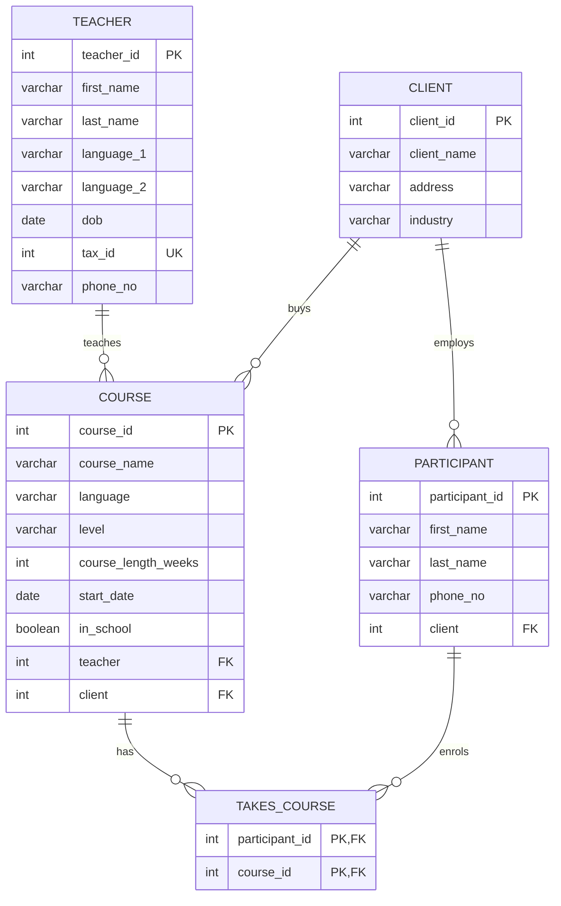

# Relational Database Design and SQL with MySQL and Python

**Goal:** Design a normalised relational database for a language school, build it on a MySQL server from Python, and use SQL to answer business questions, safely and repeatably.

**Why it matters:** Most company data lives in relational databases. A data analyst or data scientist has to model entities and relationships correctly, keep the data consistent with constraints, write correct joins and aggregations, and connect from Python without SQL injection risks. This project covers that whole cycle in one script you can run.

**Skills shown:** schema design (primary keys, foreign keys, UNIQUE, NOT NULL, a junction table for a many to many relationship), referential actions (ON DELETE CASCADE / SET NULL), DDL and DML, INNER / LEFT / RIGHT JOIN, GROUP BY / HAVING, subqueries, parameterised queries, `executemany`, transactions with rollback, and pandas integration.

---

## Entity relationship model



A participant can take several courses and a course has several participants. That many to many relationship is resolved by the junction table `takes_course`, whose composite primary key prevents duplicate enrolments.

## How to run

1. Install and start MySQL 8 (or MariaDB 10.5+): <https://dev.mysql.com/downloads/mysql/>
2. Install the Python packages: `pip install mysql-connector-python pandas`
3. Provide the credentials as environment variables. They are never written in the code.

```bash
export MYSQL_HOST=localhost
export MYSQL_USER=your_user
export MYSQL_PASSWORD=your_password
python school_database.py --reset      # --reset rebuilds the demo database `school_demo`
```

The script can be run again and again: `CREATE ... IF NOT EXISTS` and `INSERT IGNORE` make it idempotent, and `--reset` starts from a clean database. A complete run log is in [`sample_output.txt`](sample_output.txt). It was produced on MariaDB 10.11 for this rebuild; the SQL is standard MySQL 8 syntax.

---

## What the script does

| Step | SQL / Python concept | Example from the output |
|---|---|---|
| 1 | Connect; `CREATE DATABASE ... CHARACTER SET utf8mb4` | handles names such as *Müller-Rossi* and *Français intermédiaire* |
| 2 | Five tables with named foreign key constraints | `fk_course_teacher ... ON DELETE SET NULL` |
| 3 | Bulk insert with `executemany` and `%s` placeholders | 6 teachers, 5 clients, 14 participants, 9 courses, 17 enrolments |
| 4 | `SELECT` into pandas, column names read from `cursor.description` | no hand typed column lists that can drift out of sync |
| 5 | 4 table join | each participant with company, course and teacher |
| 5 | INNER vs LEFT vs RIGHT JOIN | a client without courses appears only in the LEFT JOIN (10 rows vs 9) |
| 6 | `GROUP BY` + `COUNT` | the busiest courses: *Beginner English* and *Deutsch für Anfänger*, 3 participants each |
| 6 | `SUM`, `COALESCE` | teacher workload: Niamh Murphy, 3 courses, 120 teaching weeks |
| 6 | `HAVING`, `GROUP_CONCAT` | clients buying more than one course: Big Business Federation (4; ENG, FRA) and AutoMaker AG (2; MAN, RUS) |
| 6 | Subquery | teachers older than the average teacher |
| 7 | Parameterised `UPDATE` | protection against SQL injection |
| 8 | `DELETE` with `ON DELETE CASCADE` | deleting course 20 removes its enrolment automatically |
| 8 | `ON DELETE SET NULL` | deleting a teacher keeps their courses, with `teacher = NULL` |
| 8 | `rowcount` | deleting a non existent id affects 0 rows, and the script reports it |
| 9 | Foreign key protection | `DROP TABLE teacher` is refused while `course` references it |
| 10 | Transaction | a failing second `INSERT` rolls back the first, so the data stay consistent |

## What changed from the original notebook

The original notebook was `Database-creation-and-analysis-using-MySQL.ipynb`. It followed the freeCodeCamp tutorial ["How to Create and Manipulate SQL Databases with Python"](https://www.freecodecamp.org/news/connect-python-with-sql/), which is also the source of the fictional sample data.

| Issue in the original | Fix |
|---|---|
| Credentials passed as the undefined names `YourUserName`, `YourPassword` | Environment variables, with a clear error when they are missing |
| `ALTER TABLE ... ADD FOREIGN KEY` run as separate cells; running them twice creates duplicate constraints | Named constraints defined inside `CREATE TABLE` |
| Re-running the notebook failed on duplicate primary keys | `INSERT IGNORE` plus a `--reset` option |
| Column names typed by hand for every DataFrame | Taken from `cursor.description` |
| `read_query` defined twice, the "list to DataFrame" loop copied five times | One small `Database` class |
| INNER, LEFT and RIGHT joins gave identical results, so the difference was invisible | A client without courses is added to show it |
| `DELETE ... WHERE course_id = 2034`: that id does not exist, so nothing was deleted, and it went unnoticed | Affected row count is printed; the demo deletes a real course to show CASCADE |
| Advice to bypass the DROP TABLE error with `SET FOREIGN_KEY_CHECKS = 0` | Explains why the error is protective, and how to drop tables in the right order |
| Unused imports (`sqlite3`, `matplotlib`, `numpy`) and a docstring left over from another notebook | Removed |
| New in this version | Aggregation queries, a subquery, a 4 table join and a transaction with rollback |
