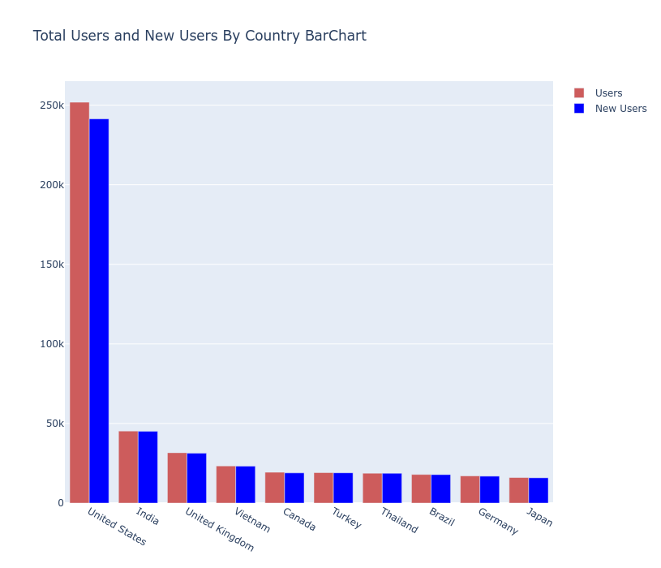
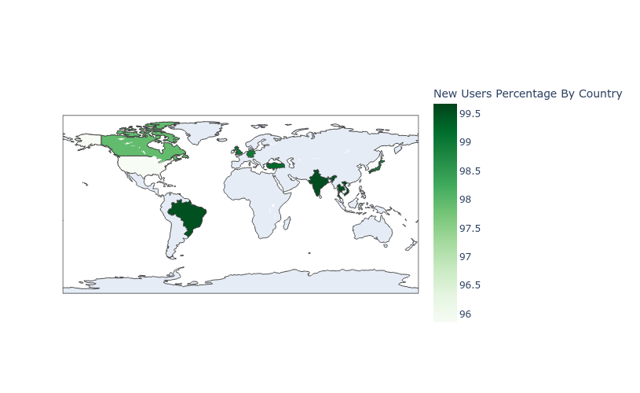
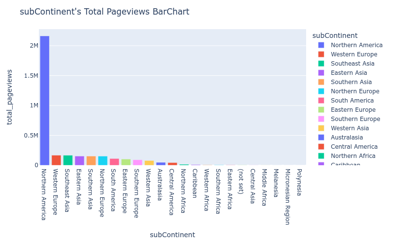

# SQL Analytics at Scale: Google BigQuery Web Analytics and a SQLite Sports Database

Two SQL projects in one folder:

1. **`ga_web_analytics.py`** analyses one year of website sessions of the Google Merchandise Store, stored in **Google BigQuery** in the nested Google Analytics 360 format.
2. **`european_soccer_sql.py`** analyses the European Soccer Database in **SQLite**, from basic joins up to window functions and CTEs.

**Why it matters:** E-commerce teams decide budgets from exactly these numbers: where visitors come from, which devices and channels convert, and how sales change over time. Knowing how to query nested cloud data cheaply and correctly, and how to write analytical SQL with joins, subqueries, CTEs and window functions, is a core skill for data analysts and data scientists.

**Skills shown:** BigQuery standard SQL, nested RECORD fields, wildcard tables with `_TABLE_SUFFIX`, conditional aggregation (`COUNTIF`, `COUNT(DISTINCT IF(...))`), window functions over aggregates, cost control (dry runs, `maximum_bytes_billed`), SQLite, self joins, subqueries that avoid fan out, CTEs, `RANK() OVER`, and data visualisation including choropleth maps.

---

## Part 1: Google Merchandise Store on BigQuery

**Data:** `bigquery-public-data.google_analytics_sample.ga_sessions_*`, with one table per day from 2016-08-01 to 2017-08-01 and one row per session. The fields used are `fullVisitorId`, `visitNumber`, `date`, `channelGrouping`, `totals.*` (pageviews, transactions, totalTransactionRevenue), `device.*` and `geoNetwork.*`.

```bash
pip install google-cloud-bigquery db-dtypes pandas matplotlib plotly
gcloud auth application-default login
python ga_web_analytics.py --project YOUR_GCP_PROJECT --dry-run   # shows GB to be scanned, costs nothing
python ga_web_analytics.py --project YOUR_GCP_PROJECT
```

| Query | Business question |
|---|---|
| `users_by_country` | Where do users come from, how many are new, what share **buy**, and how much revenue does each country bring? |
| `pageviews_by_continent` | How is engagement spread over continents (with each continent's share from a window function)? |
| `pageviews_by_subcontinent` | The same, with the Americas split correctly into North and South America |
| `conversion_by_device` | Do desktop, mobile and tablet sessions convert differently? |
| `conversion_by_channel` | Which marketing channel (organic search, referral, direct, paid search ...) brings revenue? |
| `monthly_trend` | How did sessions, users, transactions and revenue develop month by month? |

### Results from the original notebook run

The original analysis queried all 366 daily tables.

| Country | Users | New users | New % | Transactions |
|---|---|---|---|---|
| United States | 251,830 | 241,396 | 95.86 % | **11,440** |
| India | 45,289 | 45,093 | 99.57 % | 10 |
| United Kingdom | 31,653 | 31,341 | 99.01 % | 19 |
| Vietnam | 23,332 | 23,256 | 99.67 % | 0 |
| Canada | 19,356 | 18,954 | 97.92 % | 199 |
| Turkey | 19,153 | 19,009 | 99.25 % | 2 |
| Thailand | 18,792 | 18,719 | 99.61 % | 5 |
| Brazil | 17,963 | 17,880 | 99.54 % | 10 |
| Germany | 17,069 | 16,898 | 99.00 % | 8 |
| Japan | 16,041 | 15,875 | 98.97 % | 18 |

**Insight:** The US supplies about 55 % of the top 10 countries' users but almost **all of the transactions** (11,440 of 11,711 in these ten countries). India, Vietnam and Thailand bring many visitors who almost never buy. One plausible reason is that the store mainly served US customers. The data cannot confirm this, but it is the first question a marketing team should check. Nearly all visitors are first time visitors (more than 95 % in every country), so retention is weak.

| | |
|---|---|
|  |  |

**Page views by continent:** Americas 2,327,822; Asia 552,535; Europe 513,802; Oceania 48,573; Africa 31,811; not set 3,923. By sub continent, Northern America alone has 2,163,439.



### Corrections to the original analysis

The original notebook was `Comprehensive-analysis-google-cloud-dataset-using-SQL-and-BigQuery.ipynb`.

| Issue in the original | Effect | Fix |
|---|---|---|
| The Americas' page views were **split 50/50** into "North" and "South America" (the notebook itself noted this was not a true representation) | South America was shown with 1,163,911 page views. The sub continent data give **111,662**, so it was overstated more than tenfold | A SQL `CASE` on `subContinent`: North America = Northern America + Central America + Caribbean = 2,216,160; South America = 111,662. These add up exactly to the 2,327,822 for the Americas |
| `users_percentage_purchase` = transactions × 100 / users, called a percentage of users who purchased | It is **transactions per 100 users**. A user who buys 5 times counts 5 times | A real conversion rate: distinct buyers / distinct users, plus transactions and revenue as separate columns |
| `percentage_purchase_all_country` summed those ratios across countries | A sum of rates has no meaning | Removed; shares are computed from totals |
| The second map's colour bar was titled "New Users Percentage" while it showed purchases | Misleading chart | Correct titles |
| `bq_helper` (a Kaggle only helper, no longer maintained) and `DataFrame.append` | Does not run outside Kaggle notebooks or with pandas 2 | Official `google-cloud-bigquery` client with dry run cost estimates and a byte cap |
| New in this version | | Conversion by device, by channel, the monthly trend, and revenue in USD (`totalTransactionRevenue / 10⁶`) |

> **Verification note.** BigQuery needs a Google Cloud account, which was not available where this code was rebuilt. Every query was checked with a BigQuery SQL parser (`sqlglot`), and the plotting code was tested with sample data. The first live run should start with `--dry-run`.

---

## Part 2: European Soccer Database on SQLite

**Data:** Kaggle "European Soccer Database" (`database.sqlite`, about 300 MB). It holds the top leagues of 11 European countries for the 2008/2009 to 2015/2016 seasons, with match results and players with FIFA ratings. Download it from Kaggle into `data/`.

```bash
python european_soccer_sql.py --db data/database.sqlite
```

| Query | SQL technique |
|---|---|
| `tables`, `countries`, `leagues` | schema inspection, a simple JOIN |
| `first_spanish_matches` | **self join**: `Team` joined twice (home and away) |
| `league_season_stats` | `GROUP BY` three keys + `HAVING` |
| `league_rank_by_goals` | **CTE + window functions** (`RANK() OVER`, `AVG() OVER`) |
| `home_advantage` | CTE + `CASE` + conditional sums |
| `height_vs_rating` | **subquery that aggregates first**, which avoids a many to many fan out; `CASE` binning; pounds converted to kg |

### Results from the original notebook run (big five leagues, 2008/2009 to 2015/2016)

* **Home advantage is universal.** The average home minus away goal difference was positive in every league and every season, from +0.20 (Bundesliga 2009/2010) to +0.62 (Premier League 2009/2010).
* **The Bundesliga is the highest scoring league.** Its average was 2.75 to 3.16 goals per match, with the peak in 2013/2014. **Ligue 1 is the lowest**, at 2.26 to 2.54.
* The Bundesliga has 18 teams and 34 match days; the other four leagues have 20 teams and 38.
* **Height does not predict rating.** Average overall FIFA rating stays between 66.4 and 67.7 from 165 cm to 195 cm, while average weight rises from 139 lb to 196 lb (63 kg to 89 kg).

### Corrections
* The weight column is in **pounds**. The original table showed it unlabelled next to heights in cm, so it was converted to kg in SQL.
* The hard coded `path + 'database.sqlite'` became a `--db` argument.
* The original filtered on a column alias in `WHERE` (`WHERE country_name = 'Spain'`). SQLite allows this, but most databases reject it, so the query now filters on `c.name`.

> **Verification note.** The Kaggle file could not be downloaded here. The script was run end to end on a small synthetic SQLite database with the same schema. The numbers above are from the original notebook's run on the real file.
